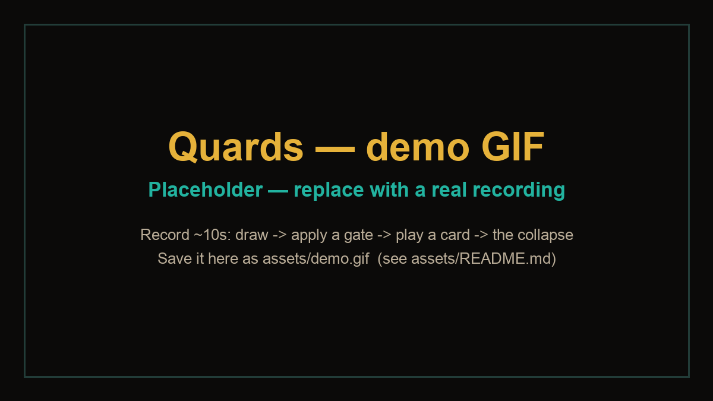

<!--
Topics (repo settings): qiskit, quantum-game, ionq, quantum-computing, unocards, educational
-->

# Quards — quantum UNO

**Every card is a qubit:** it holds two possible faces at once and only collapses to one when you play it.



> **Demo GIF placeholder.** Record ~10s of a normal turn (draw → apply a gate → play a card → the
> collapse animation), then save it as `assets/demo.gif`. See [`assets/`](assets/) for details.

## Play it now

One command (Node.js 18+, no `npm install`, no build):

```bash
node front/quards/dev-server.mjs
```

Then open <http://localhost:8000>. The default engine is a local simulator, so **no API keys and no
account are needed** to play.

## How to play

You vs. AI, heads-up. **First to empty their hand wins** (gates/cards of other kinds don't count).

- You start with **7 cards**. A card is either **classic** (one face — the usual UNO colors/numbers)
  or **quantum** (two possible faces, e.g. *Red 5* / *Blue 2*).
- On your turn you can **prepare for free** and then **play once**:
  - **Prepare:** apply any of your **gates** — `X`, `Z`, `H` (on one card) or `CNOT` (two cards).
    This costs nothing and does **not** measure.
  - **Play:** drag a card onto the discard pile. **This measures it** — or **draw** if you can't play.
- **A card is playable** if *either* of its possible faces matches the discard (same color or same
  symbol), or if it's a wild.
- **Measuring** collapses the card to one face: if it matches, the card goes to the discard and its
  effect fires; if not, the card stays in your hand (now collapsed) and **you draw 1**.
- **Gates are granted, not drawn:** you get **1 random gate every 2 of your turns**, and can hold up
  to **3**. `CNOT` entangles two cards, so measuring one fixes the other.
- **Effects (2 players):** skip/reverse → the opponent loses a turn; **+2** → opponent draws 2 and
  skips; **wild** → choose a color; **+4** → choose a color and opponent draws 4 and skips.
- **Spy ("eye"):** you start with **1** and gain **1 every 2 turns** (up to **2**). Spend one to peek
  at one of the opponent's quantum cards.

Full rules (Spanish): [`docs/idea.md`](docs/idea.md).

## The quantum part

| Game piece | Quantum object | Where in the code |
| :-- | :-- | :-- |
| Classic card | A basis state (definite `\|0⟩` or `\|1⟩`) | `back/estado.js` |
| Quantum card | A qubit in **superposition** of two faces | `back/estado.js`, prep with `ry` |
| Entangled group | Two/more qubits sharing a circuit (**CNOT**) | `back/estado.js` (`aplicarCnot`) |
| Gate X / Z / H | Single-qubit gate: `X` (bit flip), `Z` (phase), `H` (phase↔probability) | `back/quantum/referencia.js` |
| Gate CNOT | Two-qubit entangling gate | `back/quantum/referencia.js` |
| Playing a card | **Measurement** (collapse of the group) | `front/quards/services/quantum.js` |

Gate effects, each checked against the simulator: [`docs/gates.md`](docs/gates.md). Concepts in plain
language: [`docs/quantum-concepts.md`](docs/quantum-concepts.md).

## Run the circuit with Qiskit

The exact same three operations (prepare, entangle, measure) as a standalone Qiskit program. Runnable
end-to-end in [`examples/quards_circuit.ipynb`](examples/quards_circuit.ipynb) (or
[`examples/quards_circuit.py`](examples/quards_circuit.py)):

```python
import math
from qiskit import QuantumCircuit
from qiskit.quantum_info import Statevector

# Pure Qiskit (Statevector) — no backend, no Aer. Also runs in Qollab's Pyodide runtime.
def measure(qc, shots=2000):
    return Statevector(qc).sample_counts(shots)   # sampling the state IS the measurement

# A quantum card: |0> with 80% probability (the face it shows when measured).
theta = math.atan2(math.sqrt(1 - 0.6**2), 0.6)    # z = 0.6  ->  P(0) = (1+z)/2 = 0.8
card = QuantumCircuit(1)
card.ry(theta, 0)                                 # PREPARE: superposition of the two faces
print(measure(card))                              # MEASURE: collapse to one face

# An entangled pair: CNOT links two cards (only |00> and |11> appear).
pair = QuantumCircuit(2)
pair.ry(math.pi / 2, 0)                           # control card in an exact 50/50
pair.cx(0, 1)                                     # ENTANGLE: control -> target
print(measure(pair))
```

Pinned dependencies: [`examples/requirements.txt`](examples/requirements.txt)
(`qiskit==2.5.2`, `qiskit-ionq==1.1.1`, Python 3.11). The example uses only **pure Qiskit
(`Statevector`)**, so it needs no native wheels — it runs with a plain
`pip install -r examples/requirements.txt` **and** in Qollab's Pyodide environment.

**In Qollab:** the same circuit runs in the browser's Pyodide runtime — build it, then submit it to an
**IonQ simulator or QPU** by selecting the backend in *Select QPU* and pressing **Run**.

## Engines

The collapse goes through one port (`front/quards/services/quantum.js`) with three adapters:

| Engine | When | Probabilities | Measurement | Status |
| :-- | :-- | :-- | :-- | :-- |
| `referencia` | local, **default** | exact (JS simulator) | local sampling | **verified** (runs here, used by the tests) |
| `ionq` | local, `?engine=ionq` | exact (local) | IonQ REST API via dev-server proxy | **not verified** (no API key in this repo) |
| `qiskit` | inside Qollab | Qiskit `Statevector` | `backend.run` | **not verified** (requires Qollab) |

Switch engines: append `?engine=ionq` to the URL, or use the **Engine** dropdown in the header.
Probabilities are always exact (Statevector / reference). IonQ only supplies the measurement. If a
remote engine fails, it falls back to the reference simulator. Details:
[`docs/engines.md`](docs/engines.md).

## Repo layout

```
index.html  main.js  main.css   entry point (root) — mounts the game in #root
back/                           pure engine + quantum layer (no rules, no randomness of collapse)
  estado.js                     deck, cards, groups/circuits, createGame, checkState
  quantum/{util,referencia,qiskit}.js
front/quards/                   the app
  services/                     the only layer the UI knows: engine, quantum (port), rules, ai, ionq
  ui/                           DOM, card, collapse animation, background, audio, debug
examples/                       runnable Qiskit notebook + pinned requirements
docs/                           all documentation (mostly Spanish)
assets/                         demo.gif
utils/zip.js                    whole-repo zip (no dependencies)
```

Docs: [`ARCHITECTURE.md`](docs/ARCHITECTURE.md) (canonical implementation) ·
[`gates.md`](docs/gates.md) · [`quantum-concepts.md`](docs/quantum-concepts.md) ·
[`determinism.md`](docs/determinism.md) · [`engines.md`](docs/engines.md) ·
[`known-issues.md`](docs/known-issues.md) · [`roadmap.md`](docs/roadmap.md).

## What we learned

- A game is a great place to make **superposition and measurement tangible**: a card's two faces
  *are* the two basis states, and "playing" *is* measuring.
- Keeping the engine a **plain, serializable object** (`back/estado.js`) with no rules and no collapse
  randomness made the whole thing testable and the quantum port swappable.
- **Partial measurement** is subtle: measuring one card in an entangled group still conditions the
  others, so the simulator recomputes the rest of the group from the measured bits.
- Shipping to Qollab constrains the code: only **static** ES-module imports get bundled.

## Remix it

- **Smarter AI:** replace the heuristic with expectimax over the hidden probabilities.
- **Multiplayer:** move the engine to a server that holds each player's hand.
- **New quantum content:** multi-qubit GHZ states, phase gates, Grover's oracle as the spy — see the
  proposals in [`docs/mejoras/`](docs/mejoras/) and [`docs/roadmap.md`](docs/roadmap.md).

## License

MIT — see [LICENSE](LICENSE).

This effort is supported via compute credits from Qollab and IonQ.
